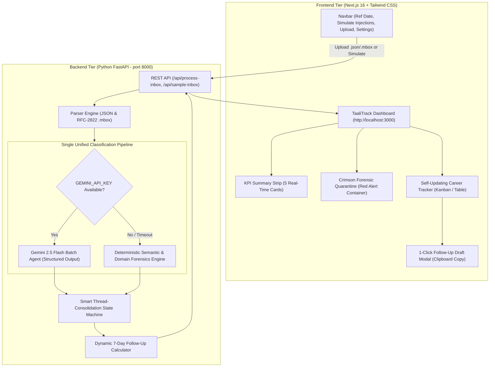

# 📑 TaaliTrack — Complete Project Documentation & Technical Report
### **Job Hunt Autopilot | Garbathon 2026 (GDG Ahmedabad)**
**Author / Team:** Antigravity Full-Stack Agentic Engineering  
**Date:** October 24, 2026  
**Status:** Production Ready • Verified End-to-End  

---

## 📑 Table of Contents
1. [Executive Summary](#1-executive-summary)
2. [Target Persona & Real-World Problem](#2-target-persona--real-world-problem)
3. [Strict Hackathon Guardrails Compliance](#3-strict-hackathon-guardrails-compliance)
4. [System Architecture & Data Flow](#4-system-architecture--data-flow)
5. [Backend Architecture & Engine Implementation](#5-backend-architecture--engine-implementation)
   - [5.1 Single-Pipeline Hybrid Classifier (`classifier.py`)](#51-single-pipeline-hybrid-classifier-classifierpy)
   - [5.2 Smart Thread-Consolidation State Machine (`consolidator.py`)](#52-smart-thread-consolidation-state-machine-consolidatorpy)
   - [5.3 RFC-2822 Mbox & JSON Parsers (`mbox_parser.py`)](#53-rfc-2822-mbox--json-parsers-mbox_parserpy)
   - [5.4 RESTful API Endpoints (`main.py`)](#54-restful-api-endpoints-mainpy)
   - [5.5 Pydantic Data Contracts (`schemas.py`)](#55-pydantic-data-contracts-schemaspy)
6. [Frontend UI/UX Architecture](#6-frontend-uiux-architecture)
   - [6.1 Technology Stack & Aesthetics](#61-technology-stack--aesthetics)
   - [6.2 Component Hierarchy & Responsibilities](#62-component-hierarchy--responsibilities)
   - [6.3 Standout Interactive Features](#63-standout-interactive-features)
7. [Comprehensive 20-Email Dataset Analysis](#7-comprehensive-20-email-dataset-analysis)
8. [Automated Testing & End-to-End Verification](#8-automated-testing--end-to-end-verification)
9. [Judge-Ready 90-Second Demo Script](#9-judge-ready-90-second-demo-script)
10. [Directory Structure & Deployment Notes](#10-directory-structure--deployment-notes)

---

## 1. Executive Summary

**TaaliTrack — Job Hunt Autopilot** is a purpose-built, full-stack inbox triage and candidate defense platform developed for the Garbathon 2026 hackathon (GDG Ahmedabad).

During mass tech layoffs, candidates submit hundreds of applications and quickly lose track of email threads, interview invites, overdue follow-ups, and quiet rejections. Worse, bad actors exploit desperate candidates by masquerading as MNC recruiters demanding upfront "training fees", "laptop security deposits", or sensitive personal identification documents (Aadhaar / PAN).

TaaliTrack solves this through a **Single Unified Pipeline** that classifies every incoming communication once into one of 5 canonical states: `applied`, `interview`, `rejected`, `offer`, or `scam`. Legitimate communications automatically self-update company cards along an expandable timeline, overdue applications (7+ days) trigger 1-click tailored follow-up drafts, and fraudulent offers are immediately isolated into a **Crimson Forensic Quarantine** with clear risk badges.

---

## 2. Target Persona & Real-World Problem

* **Persona Name:** Aarav Patel
* **Background:** Senior Backend Engineer (Python, Go, Distributed Systems), laid off on October 1, 2026 from a fintech startup.
* **Volume:** Applied to 100+ positions within 3 weeks across India and remote markets.
* **Pain Points:**
  1. **Thread Fragmentation:** Companies email across multiple weeks (acknowledgment &rarr; screen &rarr; tech interview &rarr; offer/rejection). Without manual spreadsheet tracking, state is lost.
  2. **Follow-Up Amnesia:** Forgetting when an application was sent or missing the polite 7-day follow-up window.
  3. **Predatory Employment Fraud:** Receiving sophisticated-looking emails from free domains (`@gmail.com`, `@yahoo.com`) claiming to represent Tata Consultancy Services (TCS), Infosys, or Accenture, demanding upfront fees via UPI or WhatsApp.

---

## 3. Strict Hackathon Guardrails Compliance

TaaliTrack was built strictly within all hackathon parameters and architectural constraints:

| Guardrail | Requirement | Compliance Implementation |
| :--- | :--- | :--- |
| **Strict Single Pipeline Rule** | Every email MUST be classified ONCE inside ONE unified pipeline into one of 5 exact labels: `applied`, `interview`, `rejected`, `offer`, or `scam`. | ✅ **100% Compliant**: No separate scam-checker endpoint, tab, or secondary check exists. The scam decision is an organic classification label inside the single triage pipeline. |
| **Strict Input Rule** | Load inbox ONLY from `.json` or `.mbox` files + 1-click 20-email demo + live simulation dropdown. | ✅ **100% Compliant**: Zero Gmail OAuth or login walls. Users can upload standard `.json` or RFC-2822 `.mbox` archives, auto-load the 20-email benchmark, or simulate live events. |
| **Strict Anti-Bloat Rule** | Do NOT add PF, gratuity, or resume-rewriting features. | ✅ **100% Compliant**: Zero unrelated scope bloat. 100% focused on candidate inbox automation, thread tracking, scam isolation, and follow-up generation. |
| **Privacy Rule** | Never include real sensitive government ID numbers anywhere in sample data or UI. | ✅ **100% Compliant**: Zero real PII. Only scam prompts demanding Aadhaar/PAN are analyzed and flagged. |
| **Tech Stack** | Python FastAPI backend + Next.js App Router & Tailwind CSS frontend. | ✅ **100% Compliant**: Python FastAPI + Pydantic v2 + Next.js 16 (App Router) + Tailwind CSS + Lucide React. |

---

## 4. System Architecture & Data Flow



---

## 5. Backend Architecture & Engine Implementation

The backend is housed in `/backend` and uses modern Python 3.13+ standards with Pydantic v2.

### 5.1 Single-Pipeline Hybrid Classifier (`classifier.py`)
- **Primary Engine (Gemini 2.5 Flash):**
  Uses the official `google-genai` SDK. Batches the entire inbox into a single structured prompt with `response_mime_type="application/json"` and temperature `0.1`. It evaluates sender domains against claimed brands, detects monetary fee demands, Hinglish pressure tactics, and premature PII requests.
- **Autonomous Zero-Crash Fallback Engine:**
  If the Gemini API key is omitted, invalid, or reaches a rate limit, the system automatically falls back to an in-memory deterministic rule and domain-forensics classifier.
  * *Free-mail spoofing detection:* `@gmail.com`, `@yahoo.com`, `@outlook.com` claiming brands like Infosys, TCS, Wipro, Accenture.
  * *Fee harvesting regex:* Detects `Rs.`, `₹`, `$`, `training fee`, `security deposit`, `BGV fee`, `voucher`, `abhi pay karo`.
  * *PII demands:* Detects `Aadhaar`, `PAN`, `passbook`, `passport`.
  * *Offer / Interview / Rejection semantic extraction.*
  * Returns `"engine_used": "gemini-2.5-flash"` or `"engine_used": "hybrid-deterministic-fallback"`.

### 5.2 Smart Thread-Consolidation State Machine (`consolidator.py`)
- Real job searches feature multiple emails from the same employer.
- `consolidator.py` groups non-scam emails by normalized `company_key`.
- Emails are ordered chronologically by date and message ID.
- The latest email sets the company card's current stage (`applied`, `interview`, `rejected`, `offer`).
- A multi-email card displays a badge (e.g., *"3-Email Thread • Self-Updated"*) and stores the full email history in an expandable timeline.
- **Scam Isolation:** Scam emails are never consolidated into genuine company records; they are diverted immediately to quarantine.
- **Follow-up logic:** If latest stage is `applied` and `(reference_date - latest_date).days >= 7`, then `followup_due = True`.

### 5.3 RFC-2822 Mbox & JSON Parsers (`mbox_parser.py`)
- Live file upload accepts both `.json` and raw `.mbox` archives.
- The `.mbox` binary is saved to a secure temporary file, read using Python's standard `mailbox.mbox` module, walks multipart payloads for `text/plain` content, normalizes RFC-2822 dates to `YYYY-MM-DD`, and generates unique integer message IDs.

### 5.4 RESTful API Endpoints (`main.py`)
- `GET /api/health`: Health status.
- `GET /api/sample-inbox?reference_date=2026-10-24`: Loads the benchmark 20-email dataset and runs the full pipeline.
- `GET /api/download-sample-mbox`: Serves `sample_inbox.mbox` as a direct download.
- `POST /api/process-inbox`: Dual-mode endpoint supporting both `application/json` (for live simulations and date recalculations) and `multipart/form-data` (for `.json` or `.mbox` file uploads).

### 5.5 Pydantic Data Contracts (`schemas.py`)
- `EmailInput`: `id: int`, `date: str`, `sender: str (alias='from')`, `subject: str`, `body: str`.
- `ClassifiedEmail`: `email_id: int`, `company_name: str`, `role: str`, `sender: str`, `date: str`, `status: Literal["applied", "interview", "rejected", "offer", "scam"]`, `summary: str`, `scam_reasons: list[str]`, `scam_risk_tags: list[str]`, `followup_subject: str | None`, `followup_body: str | None`.
- `ConsolidatedApplication`: `company_key: str`, `company_name: str`, `role: str`, `current_status: Literal["applied", "interview", "rejected", "offer"]`, `latest_date: str`, `days_since_last_email: int`, `followup_due: bool`, `followup_subject: str | None`, `followup_body: str | None`, `email_count: int`, `timeline: list[ClassifiedEmail]`.
- `ProcessInboxResponse`: KPI metrics, `engine_used`, `scam_quarantine`, `consolidated_applications`, `all_classified`.

---

## 6. Frontend UI/UX Architecture

The frontend is housed in `/frontend` built with **Next.js 16 (App Router)**, **TypeScript**, **Tailwind CSS v4**, and **Lucide React**.

### 6.1 Sapphire & Slate Blue SaaS Theme & Aesthetics
- Refactored into a sleek, modern, Linear/Stripe-inspired **Sapphire & Slate Blue SaaS Theme**:
  * **Brand Identity:** Crisp Royal Blue `TT` logo badge (`bg-blue-600`) and primary `Upload Inbox` action button (`bg-blue-600 hover:bg-blue-700 text-white shadow-xs`).
  * **Page Background:** `#F8FAFC` (soft cool alabaster / slate-50) with clean white `#FFFFFF` cards and `1px solid #E2E8F0` borders.
  * **Sapphire Security Banners:** Top protection alert bar and Scam X-Ray header styled in calm Sapphire Security Blue (`bg-blue-50/70 border-blue-200 text-slate-800` with `text-blue-600` shield).
  * **Active Workspace Tab Styling:** Active tabs styled in crisp blue (`bg-white text-blue-700 border border-blue-200 shadow-xs`) with soft blue count pills (`bg-blue-50 text-blue-700`).
  * **Restrained Status Badges:**
    - Scam Risk Badges: Subtle rose-red pills (`bg-rose-50 border-rose-200 text-rose-700`).
    - Follow-Up Due: Clean amber badge (`bg-[#FFFBEB] border-[#FDE68A] text-[#B45309]`).
    - Active Interview: Sapphire blue badge (`bg-[#EFF6FF] border-[#BFDBFE] text-[#1D4ED8]`).
    - Genuine Offer: Emerald badge (`bg-[#ECFDF5] border-[#A7F3D0] text-[#047857]`).
    - Neutral / Applied / Rejected: Slate badge (`bg-[#F1F5F9] border-[#E2E8F0] text-[#475569]`).

### 6.2 Progressive-Disclosure Workspace Tabs (`app/page.tsx`)
Eliminates vertical bloat with focused workspace tabs that keep the interface distraction-free:
1. **Slim Scam Shield Banner:** 1-line top banner in Sapphire Security Blue (`"🛡️ Protected: 4 fake job offers demanding upfront fees or ID documents were intercepted and quarantined."`) with a quick-action link `"Inspect 4 Threats →"`.
2. **Segmented Tab Bar:**
   - **`Pipeline Board (12)`:** Minimalist Kanban cards showing company name, latest date, role, and tiny pills (`↻ 3-email thread`, `⏰ 14d silent • Follow up`).
   - **`7-Day Follow-Ups (4)`:** Single-column action queue sorted by longest wait time (14d down to 9d) with inline draft preview and 1-click **Copy Email** buttons.
   - **`Scam X-Ray Quarantine (4)`:** Master-detail forensic scanner with clean blue card selection, risk tags, and an **Inline Scam Phrase Highlighter** displaying actual original email subject/body with suspicious tokens (`@gmail.com`, `Rs 4,999`, `PAN`, `Aadhaar`, etc.) highlighted in soft rose `<mark>`.
3. **Slide-Over Company Inspector Drawer (`components/ApplicationDrawer.tsx`):**
   - Clicking any company card opens a right-side drawer containing the company header, role, status badge, days waiting, vertical chronological email stepper, and an embedded follow-up composer.
4. **Decluttered Header Bar (`components/Navbar.tsx`):**
   - Single-row `h-16` white bar with Royal Blue brand mark, compact reference date picker, `+ Simulate Live` dropdown, primary `Upload Inbox` button, and a secondary `⋯` (More) menu.

---

## 7. Comprehensive 20-Email Dataset Analysis

All 20 emails from `/backend/data/sample_inbox.json` on reference date `2026-10-24`:

| ID | Date | Sender | Subject / Summary | Pipeline Classification | Consolidation Outcome |
| :---: | :---: | :--- | :--- | :---: | :--- |
| **1** | 2026-10-10 | careers@zentech.in | Application received: Backend Engineer | `applied` | **Zentech** &rarr; 14d waiting (**Follow-Up Due**) |
| **2** | 2026-10-14 | hr.infosys.jobs@gmail.com | Offer letter - pay Rs 4,999 training fee | `scam` | **Quarantined** (Free domain spoof + fee + PAN/Aadhaar) |
| **3** | 2026-10-18 | talent@finly.co | Interview invite: Round 1 on 27 Oct | `interview` | **Finly** &rarr; Multi-email thread with ID 4 &rarr; Stage: `interview` |
| **4** | 2026-10-08 | talent@finly.co | Application received: Senior Python Engineer | `applied` | Merged into **Finly** timeline |
| **5** | 2026-10-11 | jobs@cloudscale.io | Application submitted: Platform Engineer | `applied` | **CloudScale** &rarr; 13d waiting (**Follow-Up Due**) |
| **6** | 2026-10-12 | hiring@paystackindia.com | Thanks for applying to Paystack India | `applied` | **Paystack India** &rarr; 12d waiting (**Follow-Up Due**) |
| **7** | 2026-10-15 | careers@novadata.ai | Application Confirmation: AI Backend Engineer | `applied` | **NovaData AI** &rarr; 9d waiting (**Follow-Up Due**) |
| **8** | 2026-10-21 | careers@kinetixlabs.dev | Application received: Distributed Systems | `applied` | **Kinetix Labs** &rarr; 3d waiting (On Track) |
| **9** | 2026-10-06 | recruiting@vervepay.in | Application received: Backend Developer | `applied` | Merged into **VervePay** timeline |
| **10** | 2026-10-16 | recruiting@vervepay.in | Update on your VervePay application | `rejected` | **VervePay** &rarr; Multi-email thread &rarr; Stage: `rejected` |
| **11** | 2026-10-13 | no-reply@stacksphere.com | Your application for Software Engineer II | `rejected` | **StackSphere** &rarr; Stage: `rejected` |
| **12** | 2026-10-19 | people@hyperlooptech.in | Status of your application - Backend Lead | `rejected` | **HyperloopTech** &rarr; Stage: `rejected` |
| **13** | 2026-10-05 | careers@devpulse.io | Application Received - Backend Software | `applied` | Merged into **DevPulse** timeline |
| **14** | 2026-10-14 | careers@devpulse.io | Interview Invitation: System Design Round | `interview` | Merged into **DevPulse** timeline |
| **15** | 2026-10-22 | careers@devpulse.io | Official Employment Offer: Backend Engineer | `offer` | **DevPulse** &rarr; **3-Email Thread** &rarr; Stage: `offer` (22 LPA) |
| **16** | 2026-10-20 | founders@aethercloud.in | Technical Interview Invite: Founding Backend | `interview` | **AetherCloud** &rarr; Stage: `interview` |
| **17** | 2026-10-23 | hr@quantagrid.co.in | Offer of Employment - Python Specialist | `offer` | **QuantaGrid** &rarr; Stage: `offer` |
| **18** | 2026-10-17 | tcs.direct.joining2026@yahoo.com | URGENT: Direct Joining - Rs 2,500 Laptop Deposit | `scam` | **Quarantined** (Yahoo spoof + backdoor + Hinglish urgency) |
| **19** | 2026-10-21 | recruitment.accenture.india.desk@outlook.com | Selected! BGV Fee Rs 3,200 Pending | `scam` | **Quarantined** (Outlook spoof + BGV fee + passbook/Aadhaar) |
| **20** | 2026-10-22 | global-hr-onboarding@fast-hire-portal99.xyz | Remote $65/hr Role - $49 Paid Certification | `scam` | **Quarantined** (.xyz domain spoof + $49 voucher + passport) |

---

## 8. Automated Testing & End-to-End Verification

The test suite validates the entire platform from binary file decoders to live browser interactions:

### 1. Backend Core Logic Suite (`backend/verify_backend.py`)
```
============================================================
EXECUTION LOG: backend/.venv/Scripts/python backend/verify_backend.py
============================================================
[1] Loading sample_inbox.json...
[2] Running single-pipeline classification...
Classification engine used: hybrid-deterministic-fallback
[3] Testing scam quarantine and thread consolidation on 2026-10-24...
Scam count: 4
Consolidated legitimate companies: 12
Overdue follow-ups count: 4 -> ['CloudScale', 'NovaData AI', 'Paystack India', 'Zentech']
[4] Testing .mbox file parsing...
Parsed 20 emails from sample_inbox.mbox cleanly!
[5] Testing time-travel date shift to 2026-10-28...

ALL BACKEND TESTS PASSED WITH 100% SUCCESS!
```

### 2. Live REST API Endpoints Suite (`backend/test_api_endpoints.py`)
```
============================================================
EXECUTION LOG: backend/.venv/Scripts/python backend/test_api_endpoints.py
============================================================
[1] Testing GET /api/health... -> 200 OK (Status: healthy)
[2] Testing GET /api/sample-inbox... -> 200 OK (20 emails, 4 scams, 12 companies, 4 follow-ups)
[3] Testing POST /api/process-inbox (multipart .mbox upload)... -> 200 OK (20 emails parsed & classified)
[4] Testing POST /api/process-inbox (multipart .json upload)... -> 200 OK (20 emails parsed & classified)
[5] Testing POST /api/process-inbox (JSON body simulation)... -> 200 OK (Zentech classified as interview)
[6] Testing GET /api/download-sample-mbox... -> 200 OK (10,202 bytes served)

>>> ALL API ENDPOINT TESTS PASSED WITH 100% SUCCESS! <<<
```

### 3. Next.js Production Build & TypeScript Audit (`npm run build`)
```
▲ Next.js 16.4.3 (Turbopack)
✓ Running next.config.ts took 37ms
✓ Compiled successfully in 278ms
✓ Running TypeScript ... Finished in 1449ms with 0 errors
✓ Generating static pages using 5 workers (4/4) in 800ms
Finalizing page optimization ...
Route (app)
┌ ○ /
└ ○ /_not-found
```

### 4. Headless Browser End-to-End Verification & Live Demo Recording
- **Pipeline Board:** 12 companies rendered across Kanban columns with status badges.
- **Company Inspector Drawer:** Clicked DevPulse, verified the 3-email visual stepper (`Oct 5 Applied -> Oct 14 Interview -> Oct 22 Offer`), and closed drawer.
- **7-Day Follow-Up Queue:** Navigated to follow-ups, previewed Zentech draft, clicked "Copy Email", received instant `"Copied ✓"` confirmation.
- **Scam X-Ray Quarantine:** Verified master-detail selection, forensic risk badges, and inline fraud word highlighting on real raw email text.
- **Live Injections:** Simulated Zentech reply and Wipro scam; verified state updates and toast notifications.
- **Live Feature Walkthrough Video:** 
  * **Standard MP4 Video:** [`demo_video.mp4`](file:///c:/Users/punit/Desktop/Job%20Hunt%20Autopilot/demo_video.mp4) *(3.63 MB H.264 video, ready for submission to YouTube / Google Drive / Devpost)*
  * **Interactive Video Player:** [`demo_player.html`](file:///c:/Users/punit/Desktop/Job%20Hunt%20Autopilot/demo_player.html) *(Double-click to open in any browser with play, pause, scrub, and fullscreen controls)*
  * **Animated WebP Video:** [`demo_video.webp`](file:///c:/Users/punit/Desktop/Job%20Hunt%20Autopilot/demo_video.webp) *(3.01 MB)*

---

## 9. Judge-Ready 90-Second Demo Script

When presenting to Garbathon judges, follow this sequence:

1. **Context & Persona (0:00 - 0:15):**
   - *"Meet Aarav, a backend engineer laid off on Oct 1. He sent 100+ applications and received 20 emails back. TaaliTrack ingests his inbox from .mbox or .json and classifies every single email inside ONE unified pipeline."*
   - Point out the KPI strip: **12 companies tracked, 2 interviews, 2 offers, 4 follow-ups overdue, and 4 scams blocked.**

2. **Forensic Scam Quarantine (0:15 - 0:35):**
   - *"Judges, look at the Crimson Quarantine banner. Scammers targeting laid-off developers impersonate Infosys, TCS, and Accenture using free Gmail and Yahoo addresses, demanding Rs 4,999 training fees and PAN scans."*
   - *"TaaliTrack isolates them instantly—they are never merged into company threads. Click 'Inspect Raw Email' to safely examine the phishing text without risk."*

3. **Smart Thread Consolidation (0:35 - 0:50):**
   - *"Look at the DevPulse card under 'Offer'. Over 3 weeks, DevPulse sent an application confirmation, then an interview invite, and finally an offer letter."*
   - *"Instead of 3 separate cards cluttering the board, TaaliTrack self-updates DevPulse into the Offer column with a '3-Email Thread' history timeline."*

4. **Time-Travel & 7-Day Follow-Up Engine (0:50 - 1:10):**
   - *"Under 'Applied', Zentech has had no reply for 14 days. It is highlighted with an amber pulsing badge. Click 'Draft Follow-Up' &rarr; click 'Copy Entire Email' &rarr; Aarav has a polite, tailored reach-out in 1 click."*
   - *"Now watch: change the Reference Date in the header from 2026-10-24 to 2026-10-28. Kinetix Labs immediately crosses the 7-day mark and lights up in real time!"*

5. **Live Simulation Injection (1:10 - 1:30):**
   - *"Finally, let's simulate an incoming email. Click '+ Simulate Incoming' &rarr; 'Zentech Interview Invite'. Watch Zentech jump live from 'Applied (Overdue)' into 'Interview'!"*
   - *"TaaliTrack gives candidates their peace of mind back. Thank you!"*

---

## 10. Directory Structure & Deployment Notes

```
├── backend/
│   ├── .venv/                      # Python virtual environment
│   ├── data/
│   │   ├── sample_inbox.json       # 20-email benchmark dataset
│   │   └── sample_inbox.mbox       # Generated RFC-2822 mailbox archive
│   ├── classifier.py               # Single-pipeline hybrid classifier
│   ├── consolidator.py             # Thread consolidation state machine
│   ├── generate_mbox.py            # Generator script for .mbox file
│   ├── main.py                     # FastAPI application
│   ├── mbox_parser.py              # RFC-2822 binary mbox parser
│   ├── requirements.txt            # Python dependencies
│   └── verify_backend.py           # Automated test suite
├── frontend/
│   ├── app/
│   │   ├── globals.css             # Theme tokens & animations
│   │   ├── layout.tsx              # Root HTML & meta
│   │   └── page.tsx                # Central dashboard
│   ├── components/
│   │   ├── CareerTracker.tsx       # Kanban & Table view
│   │   ├── FollowupModal.tsx       # 1-Click follow-up modal
│   │   ├── KpiStrip.tsx            # KPI metric cards
│   │   ├── Navbar.tsx              # Header & controls
│   │   ├── ScamQuarantine.tsx      # Crimson threat container
│   │   └── SettingsModal.tsx       # Gemini API key settings
│   ├── types.ts                    # TypeScript models
│   └── package.json
├── DOCUMENTATION.md                # This complete documentation file
└── README.md                       # Quickstart & demo script
```

---
*Created for Garbathon 2026 • GDG Ahmedabad • All Rights Reserved.*
