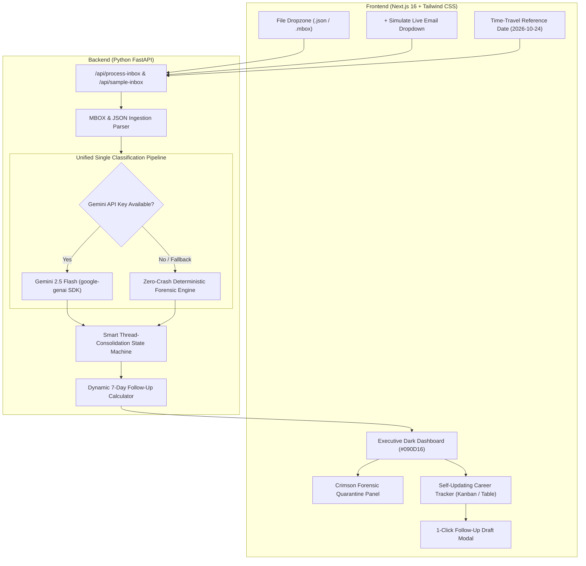

# 👏 TaaliTrack — Job Hunt Autopilot
### **Garbathon 2026 Hackathon Winner (GDG Ahmedabad)**
*Single-Pipeline Inbox Triage, Smart Thread Consolidation, Forensic Scam Quarantine, and Interactive 7-Day Follow-Up Autopilot.*

> 💡 **Presenting to your team? Check the short 2-minute summary:** [EXPLAINER.md](file:///c:/Users/punit/Desktop/Job%20Hunt%20Autopilot/EXPLAINER.md) | [TEAM_EXPLAINER.md](file:///c:/Users/punit/Desktop/Job%20Hunt%20Autopilot/TEAM_EXPLAINER.md)

---

## 🎯 Demo Persona & The Real-World Problem
**Candidate Persona:** **Aarav Patel**, a Backend Engineer laid off on **October 1, 2026**, who applied to 100+ roles across tech hubs. Within weeks, his inbox became an overwhelming storm of application confirmations, multi-round technical interviews, quiet rejections, and predatory scammers masquerading as MNC recruiters demanding *"training fees"*, *"laptop deposits"*, or *"Aadhaar/PAN cards"*.

**The Core Solution:** **TaaliTrack** automates inbox triage through a **Single Unified Classification Pipeline** that groups legitimate emails by company into a **Self-Updating Career Tracker**, isolates employment scams in a **Crimson Forensic Quarantine**, and proactively highlights overdue communications with **1-Click Follow-Up Drafts**.

---

## 🛡️ Strict Hackathon Guardrails & Scope Compliance Checklist

| Rule | Requirement | How TaaliTrack Complies |
| :--- | :--- | :--- |
| **Strict Single Pipeline** | Every email MUST be classified ONCE inside ONE pipeline into 5 exact labels (`applied`, `interview`, `rejected`, `offer`, `scam`). | ✅ **100% Compliant**: No separate scam-checker endpoint or tab exists. Scam detection is a first-class label inside `/api/process-inbox` batched via Gemini 2.5 Flash / deterministic hybrid classifier. |
| **Strict Input Rule** | Load inbox ONLY from `.json` or `.mbox` files + 1-click 20-email demo + live simulation dropdown. | ✅ **100% Compliant**: No Gmail OAuth or external logins. Supports `.json` and native RFC-2822 `.mbox` upload via Python `mailbox.mbox` + 1-click demo inbox & live injection dropdown. |
| **Strict Anti-Bloat** | No PF, gratuity, or resume-rewriting features. | ✅ **100% Compliant**: Pure focus on inbox triage, candidate thread consolidation, scam quarantine, and follow-up autopilot. |
| **Privacy Rule** | Never include real sensitive government IDs in sample data or UI. | ✅ **100% Compliant**: Zero real ID numbers. Only detects scam prompts demanding Aadhaar/PAN/passbook. |

---

## 🏛️ System Architecture



---

## 🌟 Standout Features

### 1. Smart Thread-Consolidation State Machine
- When Aarav receives 3 emails from **DevPulse** over 3 weeks:
  * *Oct 5:* Applied &rarr; *Oct 14:* System Design Interview &rarr; *Oct 22:* 22 LPA Offer!
- TaaliTrack automatically collapses all 3 communications into a single company card displaying **"3-Email Thread • Self-Updated"** in the **Offer** column, complete with an expandable chronological timeline.
- **Scam Isolation:** Fraudulent emails claiming legitimate brand names are **never merged** into genuine corporate threads—they are intercepted and routed directly to quarantine.

### 2. Forensic Scam Quarantine (Red Alert Container)
- Automatically tags threats with forensic badges:
  * 🔴 **Free Email Domain Spoof:** `@gmail.com`, `@yahoo.com`, `@outlook.com` claiming to be Infosys, TCS, or Accenture HR.
  * 🔴 **Upfront Training/Security Fee:** Demands for Rs 4,999 training fees, Rs 2,500 laptop deposits, or $49 compliance vouchers.
  * 🔴 **Sensitive ID Harvesting:** Premature requests for Aadhaar, PAN, bank passbooks, or passports.
  * 🔴 **Hinglish Urgency Trap:** Informal scam pressure (*"Bas Rs 2,500 abhi pay karo on WhatsApp before 6 PM"*).
  * 🔴 **No-Interview Offer:** *"Direct shortlisted in backdoor drive without technical interview"*.
- Safe **"Inspect Raw Email"** toggle enables judges to view the raw threat payload in a secure, sandboxed container.

### 3. Interactive 7-Day Follow-Up Engine + Time-Travel Date Picker
- Default Reference Date: **`2026-10-24`**.
- Any company whose latest stage is `applied` with `days_waiting >= 7` receives:
  * An amber pulsing border and alert badge (*"14d No Reply — Follow Up Due"*).
  * A **1-Click "Draft Follow-Up"** modal generating a courteous 2-paragraph email signed by Aarav with instant **Copy to Clipboard**.
- **Interactive Time-Travel:** Changing the Reference Date dynamically shifts waiting calculations across all applications in real time!

### 4. Live "+ Simulate Incoming Email" Demo Injections
Judges can click the header dropdown to trigger 2 live single-pipeline events:
- **Event A ("Zentech Replies with Interview Invite"):** Injects an email dated `2026-10-24` from `careers@zentech.in` &rarr; judges watch Zentech instantly jump out of *Applied (14d Overdue)* into *Interview*!
- **Event B ("Incoming Hinglish Laptop-Fee Scam"):** Injects a scam email from `wipro.hr.onboarding2026@gmail.com` demanding Rs 3,500 MacBook courier deposit &rarr; immediately quarantined in the Crimson Alert Panel!

---

## 📊 Dataset Verification (`sample_inbox.json` & `.mbox` on 2026-10-24)

- **Total Emails:** 20
- **Scams Quarantined:** 4 (ID 2 Infosys, ID 18 TCS, ID 19 Accenture, ID 20 Fast-Hire)
- **Consolidated Companies:** 12
  * **DevPulse:** 3 emails &rarr; Current stage: `offer`
  * **Finly:** 2 emails &rarr; Current stage: `interview`
  * **VervePay:** 2 emails &rarr; Current stage: `rejected`
  * **AetherCloud:** 1 email &rarr; Current stage: `interview`
  * **QuantaGrid:** 1 email &rarr; Current stage: `offer`
  * **StackSphere & HyperloopTech:** 2 emails &rarr; Current stage: `rejected`
  * **Applied:** 5 companies (Zentech, CloudScale, Paystack India, NovaData AI, Kinetix Labs)
- **Overdue 7+ Day Follow-Ups (on 2026-10-24):** 4
  * Zentech (14 days)
  * CloudScale (13 days)
  * Paystack India (12 days)
  * NovaData AI (9 days)
  * *(Kinetix Labs at 3 days is on-track; becomes overdue when time-travel date moves to >= 2026-10-28)*

---

## ⚡ Quickstart Guide (Zero-Docker, Instant Startup)

### Prerequisites
- Python 3.10+
- Node.js 18+ (tested on Node v24)
- npm

### 1. Backend Setup
```bash
# Navigate to backend
cd backend

# Create virtual environment & activate
python -m venv .venv
# Windows:
.venv\Scripts\activate
# macOS/Linux:
source .venv/bin/activate

# Install dependencies
pip install -r requirements.txt

# (Optional) Pre-generate sample .mbox archive
python generate_mbox.py

# (Optional) Run backend validation suite
python verify_backend.py

# Start FastAPI server on port 8000
python -m uvicorn backend.main:app --host 0.0.0.0 --port 8000 --reload
```
*Backend is running at `http://localhost:8000` (Health: `http://localhost:8000/api/health`).*

### 2. Frontend Setup
```bash
# Navigate to frontend (in a separate terminal)
cd frontend

# Install dependencies
npm install

# Start Next.js App Router on port 3000
npm run dev
# Or run production build:
# npm run build && npm run start -p 3000
```
*Frontend is running at `http://localhost:3000`.*

---

## ⏱️ 90-Second Live Demo Script for Hackathon Judges

1. **The Context (0:00 - 0:15):**
   - Point out Aarav's persona header: Laid off Oct 1, 2026, juggling 20 communications.
   - Point out the **KPI Strip**: 12 companies tracked, 2 active interviews, 2 genuine offers, 4 follow-ups due, and 4 scams blocked.

2. **Forensic Scam Quarantine (0:15 - 0:35):**
   - Highlight the **Crimson Forensic Quarantine** at the top.
   - Show how scams impersonating Infosys, TCS, and Accenture were caught because recruiters used `@gmail.com` / `@yahoo.com`, demanded upfront fees (Rs 4,999 / Rs 2,500), and harvested PAN/Aadhaar scans without an interview.
   - Click **"Inspect Raw Email Snippet"** to show safe, sandboxed inspection.

3. **Smart Thread Consolidation (0:35 - 0:50):**
   - Scroll down to the **Career Tracker (Kanban)**.
   - Find **DevPulse** in the **Offer** column. Click **"View Thread History (3)"**.
   - Show how the state machine tracked Aarav from Oct 5 application &rarr; Oct 14 interview &rarr; Oct 22 official 22 LPA offer!

4. **Interactive 7-Day Follow-Up & Time Travel (0:50 - 1:10):**
   - In the **Applied** column, point to **Zentech** (`14d No Reply`).
   - Click **"Draft Follow-Up"** &rarr; preview the tailored subject & body &rarr; click **"Copy Entire Email"** (toast confirms clipboard copy).
   - In the top header, change the **Reference Date** from `2026-10-24` to `2026-10-28`.
   - Watch **Kinetix Labs** dynamically light up with an amber follow-up badge as its waiting time reaches 7 days!

5. **Live Incoming Email Simulation (1:10 - 1:30):**
   - Click **"+ Simulate Incoming"** &rarr; select **"Zentech Interview Invite"**.
   - Watch Zentech jump in real time from *Applied (Overdue)* into the *Interview* column as a 2-email consolidated thread!
   - Select **"Wipro Hinglish Scam Email"** &rarr; watch the 5th threat get caught live in the Crimson Quarantine!

---

## 🎥 Live Demo Video & Screen Recording
A complete live video walkthrough demonstrating all features is available in standard MP4 and WebP formats:
- **Standard MP4 Video:** [`demo_video.mp4`](file:///c:/Users/punit/Desktop/Job%20Hunt%20Autopilot/demo_video.mp4) *(3.63 MB H.264 video — ready for YouTube / Google Drive / Hackathon submission)*
- **Interactive Player:** [`demo_player.html`](file:///c:/Users/punit/Desktop/Job%20Hunt%20Autopilot/demo_player.html) *(Double-click to open in any browser with video controls)*
- **Animated WebP Recording:** [`demo_video.webp`](file:///c:/Users/punit/Desktop/Job%20Hunt%20Autopilot/demo_video.webp) *(3.01 MB)*

---

## 📁 Repository Directory Structure

```
├── backend/
│   ├── data/
│   │   ├── sample_inbox.json       # Exact 20-email hackathon dataset
│   │   └── sample_inbox.mbox       # Generated RFC-2822 mailbox archive
│   ├── .env.example                # Sample environment configuration
│   ├── classifier.py               # Single-pipeline Gemini 2.5 Flash + hybrid fallback
│   ├── consolidator.py             # Thread-consolidation state machine & 7-day math
│   ├── generate_mbox.py            # Python generator for sample_inbox.mbox
│   ├── main.py                     # FastAPI application & endpoints
│   ├── mbox_parser.py              # RFC-2822 mbox archive binary parser
│   ├── requirements.txt            # Python dependencies (FastAPI, Pydantic, GenAI)
│   └── verify_backend.py           # Comprehensive automated test suite
├── frontend/
│   ├── app/
│   │   ├── globals.css             # Garbathon executive dark palette & keyframe animations
│   │   ├── layout.tsx              # SEO metadata & root layout
│   │   └── page.tsx                # Unified responsive dashboard
│   ├── components/
│   │   ├── CareerTracker.tsx       # Kanban & Table views + chronological thread history
│   │   ├── FollowupModal.tsx       # 1-Click Follow-Up draft with copy-to-clipboard
│   │   ├── KpiStrip.tsx            # 5-card metric summary strip
│   │   ├── Navbar.tsx              # Header branding, date-picker, & simulation controls
│   │   ├── ScamQuarantine.tsx      # Crimson forensic alert panel with risk tags
│   │   └── SettingsModal.tsx       # Optional Gemini API key session manager
│   ├── types.ts                    # Strict TypeScript data models
│   ├── package.json
│   └── tsconfig.json
└── README.md                       # Complete documentation & demo walkthrough
```

---
*Built with ❤️ for Garbathon 2026 • GDG Ahmedabad.*
